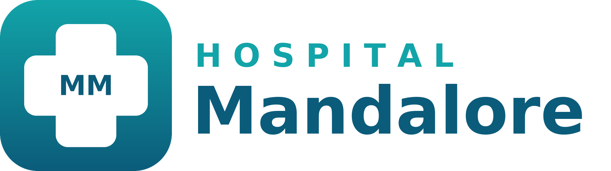

# Customização visual do Chatwoot — Hospital Mandalore

Documenta a troca da marca "Chatwoot" pela identidade fictícia **Hospital Mandalore** (sigla **MM**) na instalação self-hosted via Docker Compose em `~/chatwoot`.

A customização é empacotada numa **imagem Docker própria** (`hospital-mandalore/chatwoot`), construída a partir da imagem oficial. Nenhum passo manual é necessário: basta `docker compose up -d --build`.

- Imagem base: `chatwoot/chatwoot:v4.18.0` (edição Community)
- Imagem gerada: `hospital-mandalore/chatwoot:v4.18.0`
- URL de acesso: `http://192.168.0.79` (porta 80) ou `http://localhost:3000`



## O que foi alterado

| Item | Antes | Depois |
|---|---|---|
| Nome da instalação / título da aba | Chatwoot | Hospital Mandalore |
| Título da tela de login | Entrar no Chatwoot | Hospital Mandalore Login |
| Logo (tema claro e escuro) | logo Chatwoot | logo Hospital Mandalore |
| Ícone (sidebar, thumbnail) | balão azul | cruz médica "MM" |
| Favicons, ícones Apple/Android/MS | Chatwoot | cruz médica "MM" |
| `manifest.json` (PWA) | Chatwoot | Hospital Mandalore / MM |

Identidade visual:

- Degradê azul-petróleo `#12A4A8` (topo) → `#0B5C7A` (base)
- Cruz médica branca com "MM" (a sigla é omitida nos favicons de 16 e 32 px por legibilidade)
- Ponto vermelho `#E53935` nos favicons de notificação (`favicon-badge-*`)

## Estrutura

```
~/chatwoot/
├── docker-compose.yaml      # usa e constrói a imagem customizada
└── branding/                # contexto de build da imagem
    ├── Dockerfile           # FROM imagem oficial + customizações
    ├── custom_branding.rb   # initializer Rails: grava nome/logos no banco
    ├── .dockerignore
    ├── generate.py          # gera as imagens e o manifest.json (não vai para a imagem)
    ├── README.md            # este documento
    ├── public/              # copiado para /app/public na imagem
    │   ├── brand-assets/
    │   │   ├── logo.svg            # logo tema claro
    │   │   ├── logo_dark.svg       # logo tema escuro
    │   │   └── logo_thumbnail.svg  # ícone quadrado
    │   ├── favicon-*.png, favicon-badge-*.png
    │   ├── apple-icon-*.png, apple-touch-icon*.png
    │   ├── android-icon-*.png, ms-icon-*.png
    │   └── manifest.json
    └── preview/             # apenas visualização
```

## Como funciona

O `Dockerfile` faz três coisas sobre a imagem oficial:

1. **Arquivos estáticos:** copia `public/` por cima de `/app/public/` (favicons, ícones, logos, manifest).
2. **Título do login:** o texto `Entrar no Chatwoot` / `Login to Chatwoot` é uma string de tradução compilada no JavaScript (`/app/public/vite/assets/*.js`). O build troca por `LOGIN_TITLE` com `sed` e remove os `.gz`/`.br` correspondentes. **O build falha** se o texto original não for encontrado (sinal de que uma versão nova do Chatwoot mudou a string).
3. **Nome e logos no banco:** o Chatwoot lê nome e logos da tabela `installation_configs`, não de variáveis de ambiente. O initializer `custom_branding.rb` (instalado como `config/initializers/zz_custom_branding.rb`) roda a cada boot e grava:

   | Chave | Valor |
   |---|---|
   | `INSTALLATION_NAME` | `BRAND_NAME` |
   | `BRAND_NAME` | `BRAND_NAME` |
   | `LOGO` | `/brand-assets/logo.svg?v=LOGO_VERSION` |
   | `LOGO_DARK` | `/brand-assets/logo_dark.svg?v=LOGO_VERSION` |
   | `LOGO_THUMBNAIL` | `/brand-assets/logo_thumbnail.svg?v=LOGO_VERSION` |

   Só escreve quando o valor difere e ignora erros (ex.: banco ainda não criado). Também ajusta os valores padrão em `config/installation_config.yml`, usados em instalações novas.

### Parâmetros de build

Definidos em `docker-compose.yaml` (serviço `rails` → `build.args`):

| Arg | Valor atual | Uso |
|---|---|---|
| `CHATWOOT_IMAGE` | `chatwoot/chatwoot:v4.18.0` | imagem oficial base |
| `BRAND_NAME` | `Hospital Mandalore` | nome da instalação |
| `LOGIN_TITLE` | `Hospital Mandalore Login` | título da tela de login |
| `LOGO_VERSION` | `3` | sufixo `?v=` dos logos, para invalidar cache do navegador |

O `rails` constrói a imagem; o `sidekiq` (e o `base`) usam a mesma tag `hospital-mandalore/chatwoot:v4.18.0` via a âncora `&base`.

### Variável de ambiente opcional

`CUSTOM_BRANDING_ENFORCE=false` (no `.env`) desliga o initializer, permitindo editar nome/logos pelo painel Super Admin sem que sejam sobrescritos no próximo boot.

## Operações comuns

Todos os comandos rodam em `~/chatwoot`.

### Subir / aplicar alterações

```bash
docker compose up -d --build
```

Depois, no navegador: **Ctrl+Shift+R** (ou aba anônima).

### Mudar nome ou título do login

Edite `build.args` no `docker-compose.yaml` e rode `docker compose up -d --build`.

### Trocar logos / cores / sigla

Edite as constantes no topo de `generate.py` (`NAME`, `SHORT`, `TOP`, `BOTTOM`, `BADGE`), ou substitua diretamente os arquivos em `public/`, e então:

```bash
cd ~/chatwoot/branding && python3 generate.py   # requer Python 3 + Pillow
cd .. 
# incremente LOGO_VERSION no docker-compose.yaml (3 -> 4)
docker compose up -d --build
```

O Chatwoot serve arquivos estáticos com cache de 1 ano; sem incrementar `LOGO_VERSION` o navegador continua mostrando o logo antigo. Favicons não têm versão: use Ctrl+Shift+R.

### Atualizar a versão do Chatwoot

1. Troque a versão em `CHATWOOT_IMAGE` e na tag `image:` do `base` (ex.: `v4.19.0`).
2. `docker compose up -d --build`.
3. Se o build falhar com "Texto do login não encontrado no bundle", a string mudou na nova versão: descubra o texto novo com
   `docker run --rm chatwoot/chatwoot:<versão> sh -c 'grep -ohE "TITLE:\"[^\"]*Chatwoot\"" /app/public/vite/assets/*.js | sort -u'`
   e ajuste o `sed` no `Dockerfile`.

### Verificar se está aplicado

```bash
# nome e logos vindos do banco
curl -s http://localhost:3000/app/login | grep -oE '"(INSTALLATION_NAME|BRAND_NAME|LOGO[A-Z_]*)":"[^"]*"'

# favicon servido é o gerado
curl -s http://localhost:3000/favicon-32x32.png | md5sum; md5sum branding/public/favicon-32x32.png

# título do login (0 = nenhum texto antigo restante)
docker exec chatwoot-rails-1 sh -c 'grep -cE "Entrar no Chatwoot|Login to Chatwoot" /app/public/vite/assets/DashboardIcon-*.js'
```

### Reverter para o Chatwoot original

1. No `docker-compose.yaml`, volte `image:` do `base` para `chatwoot/chatwoot:v4.18.0` e remova o bloco `build:` do `rails`.
2. Volte os valores no banco:

   ```bash
   docker compose exec -T rails bundle exec rails runner '
   { "INSTALLATION_NAME" => "Chatwoot", "BRAND_NAME" => "Chatwoot",
     "LOGO" => "/brand-assets/logo.svg", "LOGO_DARK" => "/brand-assets/logo_dark.svg",
     "LOGO_THUMBNAIL" => "/brand-assets/logo_thumbnail.svg"
   }.each { |k, v| c = InstallationConfig.find_or_initialize_by(name: k); c.value = v; c.save! }
   GlobalConfig.clear_cache'
   ```

3. `docker compose up -d`.

## Distribuir a imagem / outro servidor

Opção 1 — levar o código: copie `docker-compose.yaml` e a pasta `branding/` e rode `docker compose up -d --build`.

Opção 2 — publicar a imagem pronta num registry:

```bash
docker tag hospital-mandalore/chatwoot:v4.18.0 <registry>/hospital-mandalore/chatwoot:v4.18.0
docker push <registry>/hospital-mandalore/chatwoot:v4.18.0
```

No outro servidor, use essa tag em `image:` e remova o bloco `build:`. Como o initializer grava nome e logos no boot, não é preciso backup do banco para a marca.

## BioSaúde na VPS (Coolify + GHCR)

A VPS (`https://bs-chat.jscinfor.com`) roda o Chatwoot pelo template do Coolify. A imagem com a marca BioSaúde é construída pelo GitHub Actions (`.github/workflows/chatwoot-image.yml`) e publicada no GHCR; no Coolify só se troca a imagem.

Marca, cores, título do login e versão do Chatwoot ficam no bloco `env:` do workflow. O workflow roda `generate.py` com esses valores antes do build, então os arquivos de `public/` do Hospital Mandalore no repositório não precisam mudar.

### Publicar a imagem

1. Crie um repositório **privado** no GitHub e envie a pasta `~/chatwoot` (o `.gitignore` deixa o `.env` de fora).
2. Em **Actions → Imagem Chatwoot BioSaúde → Run workflow**. Também roda sozinho a cada push em `branding/`.
3. Resultado: `ghcr.io/<owner>/biosaude-chatwoot:v4.19.1` (e uma tag `v4.19.1-<número da execução>` para voltar versão).
4. Na primeira vez, em **GitHub → perfil → Packages → biosaude-chatwoot → Package settings**, mude a visibilidade para **Public**. A imagem só tem logos e nomes; senhas ficam no Coolify.

### Usar no Coolify

No serviço do Chatwoot → **Edit Compose File**, troque só o `image:` dos serviços do Chatwoot web e do Sidekiq (os dois usam a mesma imagem):

```yaml
image: 'ghcr.io/<owner>/biosaude-chatwoot:v4.19.1'
```

Salve e clique em **Redeploy**. Banco, volumes, domínio e SSL continuam os mesmos.

Conferir:

```bash
curl -s https://bs-chat.jscinfor.com/app/login | grep -oE '"(INSTALLATION_NAME|BRAND_NAME|LOGO[A-Z_]*)":"[^"]*"'
```

### Mudar marca ou versão

Edite o `env:` do workflow (para logos novos, incremente `LOGO_VERSION`; para nova versão do Chatwoot, troque `CHATWOOT_VERSION`), faça push, espere o workflow e atualize a tag no Coolify se a versão mudou. Depois **Redeploy**.

## Pontos de atenção

- **Atualização do Chatwoot:** sempre fixe uma versão (`vX.Y.Z`), evite `latest`. O build acusa se o título do login não puder ser trocado.
- **Super Admin:** com o initializer ativo, alterações de nome/logos feitas pelo painel são revertidas no próximo boot. Use `CUSTOM_BRANDING_ENFORCE=false` se quiser gerenciar por lá.
- **Ainda com "Chatwoot":** links `BRAND_URL`, `WIDGET_BRAND_URL`, `TERMS_URL` e `PRIVACY_URL` (apontam para chatwoot.com), o título do painel Super Admin (`SuperAdmin | Chatwoot`) e a meta description da página (texto em inglês "... is a customer support solution ...").
